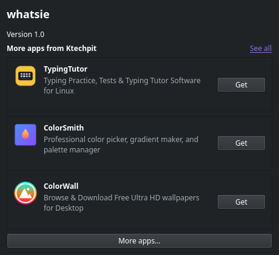

# KtechpitApps

"More apps from Ktechpit" for Ktechpit's Qt desktop apps: cards that suggest the other apps,
for an About dialog, a What's new sheet, a welcome page or a menu entry. Qt 6.5+, Widgets,
C++17. MIT licence.



## What it shows

The catalog comes from `https://ktechpit.com/USS/public/api/apps.php` (the USSPublic site:
`api/apps.php`, built from `includes/products.php` and the tags in `includes/app_tags.php`).
A copy is bundled in the resources, so the cards work offline and on the first start. About 20
seconds after start, and at most once every 7 days, the module downloads the current list and
keeps it in `~/.cache/ktechpit-apps/`, with the icons. It sends nothing about the user: a GET
of the list and of the icons, with the user agent `KtechpitApps/1 (<host id>)`.

Which apps, in which order:

- never the host app, never an app for another platform, never one installed here as a snap
  or a Flatpak;
- apps that share the most tags with the host app first (Whatsie, `chat` `text`, gets
  Paraphrase, Glate and OmniDict first), then trending apps, then the site's own order.

**Get** opens the store page in the desktop's software centre for the way the host app was
installed: `snap://<name>` for a snap, `appstream://<flatpak id>` for a Flatpak or a distro
package, the product page for an AppImage or on Windows. Clicking the card opens the product
page. Web links carry `?ref=<source>-<place>` (for example `ref=red-about`), so the site's logs
show which app and which spot a visit came from.

## Add it to an app

Pull it in as a subtree (once):

```sh
git subtree add --prefix src/modules/KtechpitApps git@github.com:keshavbhatt/ktechpit-apps.git main --squash
```

and later updates with `git subtree pull` and the same arguments. Then:

```cmake
add_subdirectory(src/modules/KtechpitApps)
target_link_libraries(myapp PRIVATE ktechpit_apps)
```

```cpp
#include "AppCatalog.h"
#include "AppStrip.h"
#include "MoreAppsDialog.h"

// once, after QApplication
ktechpit::CatalogConfig config;
config.hostAppId = u"whatsie"_s;            // the app's slug on ktechpit.com
config.package = ktechpit::Package::Flatpak; // how this copy was installed
config.source = u"whatsie"_s;               // ?ref=whatsie-<place>
ktechpit::AppCatalog::init(config);
ktechpit::AppCatalog::instance()->setEnabled(settings.showOtherApps()); // the user's choice

// in the About dialog: a heading, 3 cards and a "See all" link
layout->addWidget(new ktechpit::AppStrip(u"about"_s, 3));

// a menu entry
ktechpit::MoreAppsDialog(u"menu"_s, this).exec();
```

The widgets draw with the host's palette and fonts. Object names for style sheets:
`ktechpitAppCard`, `ktechpitAppStrip`, `ktechpitMoreAppsDialog`.

Give users a way to turn it off (a "Show other Ktechpit apps" setting that calls
`setEnabled`); every strip then hides.

## Rules for using it

- Only in places the user opens: About, What's new, welcome, a menu entry. Never a pop-up,
  never over the app's main work.
- At most one strip per screen.
- A setting turns it off.

## Develop

```sh
cmake -S . -B build -DKTECHPIT_APPS_BUILD_TESTS=ON -DKTECHPIT_APPS_BUILD_DEMO=ON
cmake --build build && ctest --test-dir build
build/ktechpit_apps_demo whatsie            # an About-like window as Whatsie
build/ktechpit_apps_demo red grab.png       # saves grab.png and grab-all.png, then quits
```

`scripts/update-catalog.sh` refreshes the bundled catalog, icons and `.qrc` from the live
endpoint; run it before tagging a release of the module.

## Adding an app to the catalog

On the site: the product goes in `includes/products.php` as before; add its tags (and a short
name) to `includes/app_tags.php`. Set `'promote' => false` to keep a product out of the apps
(KimiDoc, a server product). Installed apps pick it up within a week; run
`scripts/update-catalog.sh` here so new installs have it too.
